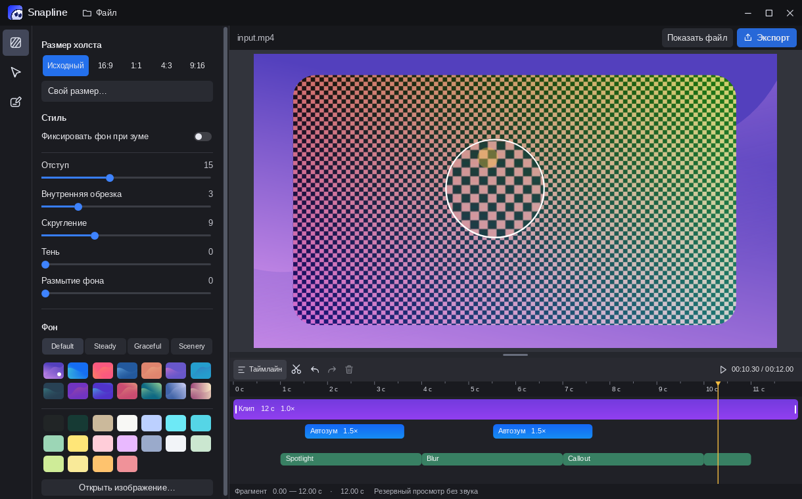

<h1 align="center">Snapline</h1>

Record your screen and edit screencasts on Windows and Mac.

<a href="README.ru.md">Русский</a> · <a href="#install">Installation</a> · <a href="#editor">Editor</a> · <a href="https://github.com/dmitryjs/snapline/releases">Releases</a>

## Installation

Snapline 0.9.1 is an early release. Downloads for both platforms are paused while I investigate antivirus alerts. [Release status](https://github.com/dmitryjs/snapline/releases/tag/desktop-1)

| Edition | Compatibility | Package |
| --- | --- | --- |
| Windows | Windows 10 22H2 or Windows 11, x64 | ZIP containing the app and recording tools |
| Mac Preview | macOS 10.15+ on Intel or macOS 11+ on Apple silicon | ZIP containing the universal Snapline.app |

## Interface language

In builds from the current source, open **File → Language** on Windows or **Snapline → Language** on Mac. Choose **English** or **Русский**, then restart Snapline. On first launch, Russian is selected on Russian-language systems and English on other systems. The original 0.9.1 downloads predate this setting.

## Editor

On Windows, trim a recording, move zoom segments on the timeline, and add masks. The padded background stays fixed as the recording zooms in.

The Mac preview supports screen or region capture, microphone audio, pause and resume, capture resolutions up to 2160p, automatic click zoom, manual zoom, three-second masks, gradients, trimming, and MP4 export. Keep the .snapclicks file next to the original recording to edit automatic zooms later.

The published Mac preview launched and exported a test MP4 with automatic zoom and a fixed background on macOS 15. Live screen capture with macOS permissions still needs testing. Advanced cursor settings and effect tracks are available on Windows. [Mac verification run](https://github.com/dmitryjs/snapline/actions/runs/45769644832)
